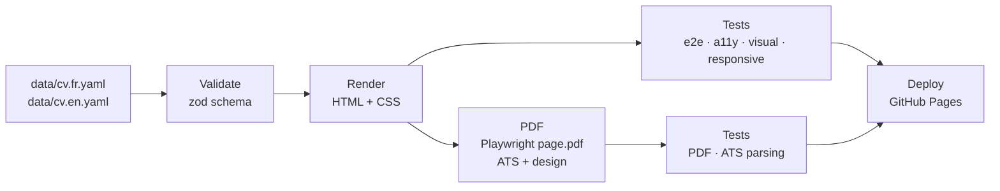

# cv-as-code

[](https://github.com/wassimaskri-99/cv-as-code/actions/workflows/ci.yml)
[](https://wassimaskri-99.github.io/cv-as-code/)

My CV, built and tested like a product.

One YAML file per language is the single source of truth. A small TypeScript build turns it into a web page and two one-page A4 PDFs, in French and English. Every change goes through 94 automated tests before GitHub Actions deploys it.

📄 **See it live:** [French](https://wassimaskri-99.github.io/cv-as-code/fr/) · [English](https://wassimaskri-99.github.io/cv-as-code/en/)

I'm a QA Automation Engineer, so this repo is also a small demo of how I test things.

## Two versions from the same data

| Version                                      | Layout                                                                                                                                                                                                                                            | Use it for                                               |
| -------------------------------------------- | ------------------------------------------------------------------------------------------------------------------------------------------------------------------------------------------------------------------------------------------------- | -------------------------------------------------------- |
| **ATS** (`Wassim_Askri_CV_QA_FR.pdf`)        | One column in plain reading order, no photo, no icons, no tables, skills as plain text, numeric dates (`04/2026`). Inspired by [Jake's Resume](https://github.com/jakegut/resume) and [RenderCV](https://github.com/rendercv/rendercv) "classic". | Uploading to job portals and applicant tracking systems  |
| **Design** (`…_Design.pdf` and the web page) | Two columns, photo, skill tags                                                                                                                                                                                                                    | Email, LinkedIn, referrals: when a person reads it first |

Why two: modern ATS parsers handle two columns fine, but older ones (Taleo, some SuccessFactors setups, still common at large French groups and IT consulting firms) can read columns in the wrong order. A one-column file removes that risk; the designed one stays for human readers.

## How it works



| Folder               | What's in it                                               |
| -------------------- | ---------------------------------------------------------- |
| `data/`              | The CV content, one YAML file per language                 |
| `src/`               | Schema, loader, renderer, build, PDF export, local server  |
| `templates/`         | HTML shell, CSS, photo                                     |
| `tests/`             | One folder per kind of test, plus the `CvPage` page object |
| `.github/workflows/` | The CI pipeline                                            |

## The tests

| Project      | What it checks                                                                                                                                                                                                                                                                                                      |
| ------------ | ------------------------------------------------------------------------------------------------------------------------------------------------------------------------------------------------------------------------------------------------------------------------------------------------------------------- |
| `data`       | Both YAML files match the schema; FR and EN have the same jobs, bullets and skills; no empty text; dates are valid and in order; no `TODO`; no phone number published                                                                                                                                               |
| `dist`       | The build produced every page and PDF; no `TODO` or leftover template markup in the HTML                                                                                                                                                                                                                            |
| `e2e`        | Name, title, every section and job are visible; the FR/EN switch works; email, LinkedIn and GitHub links are correct; every internal link and asset loads                                                                                                                                                           |
| `a11y`       | axe-core finds zero critical or serious WCAG 2.1 AA violations                                                                                                                                                                                                                                                      |
| `responsive` | No horizontal scroll on a 375px phone                                                                                                                                                                                                                                                                               |
| `visual`     | Screenshots on desktop and mobile match the approved baselines                                                                                                                                                                                                                                                      |
| `pdf`        | Each PDF has exactly one page, weighs under 1 MB, contains the name and every job title, and nothing is cut off at the bottom                                                                                                                                                                                       |
| `ats`        | Reads the ATS PDF as a parser does (pdf.js text layer): real text with digits; no ligature, replacement or private-use characters; contact details in the first 15%; sections in the expected order; each job's bullets stay under that job; one date format; every skill as plain text; no images, tables or icons |

A few choices worth explaining:

- **The tests were checked against real breakage.** I broke the CV on purpose six ways (missing bullet in English, `TODO` left in, dates reversed, text too big for the page, page wider than a phone, low-contrast color). Each one turned the suite red.
- **The ATS tests catch column problems.** Given the two-column design PDF instead, the reading-order and date-format checks fail.
- **LinkedIn isn't requested live.** It answers automated requests with HTTP 999, so the test checks the exact URL instead. GitHub gets a real request.
- **Screenshots are taken on Linux only.** Fonts render differently on macOS, so the visual tests run in Playwright's Docker image, both in CI and locally.
- **No hidden flakiness.** `retries: 0` locally and `1` in CI. A test that only passes on retry is marked flaky in the report.

## Run it locally

Needs Node 22+ and, for the visual tests, Docker.

```bash
npm install
npx playwright install chromium

npm run build          # dist/fr, dist/en: HTML + PDF
npm run serve          # http://localhost:4173

npm test               # every test except visual (needs a build first)
npm run test:data      # schema + content, no browser
npm run test:e2e       # e2e + a11y + responsive + build output
npm run test:pdf       # PDF + ATS parsing
npm run test:visual    # in Docker, same image as CI

npm run report         # open the last HTML report
```

After an intended design change, update the screenshots and commit them:

```bash
npm run test:visual:update
```

To change the CV, edit `data/cv.fr.yaml` and `data/cv.en.yaml`, keep them in sync (the tests will tell you if not), then `npm run build`.

## CI pipeline

`lint + type-check` → `schema + content tests` → `build` → `e2e + a11y + responsive`, `visual`, `PDF` in parallel → `deploy` (main only).

Any failing test stops the pipeline before deploy. Each run keeps the Playwright reports and both PDFs as downloadable artifacts.

## What this demonstrates

- **Test strategy**: fast data checks first, browser tests on the real build, one Playwright project per concern
- **Data validation**: a zod schema as the contract, plus rules a schema can't express (FR/EN parity, date order, privacy)
- **CI/CD**: parallel jobs on one build artifact, reports as artifacts, deploy only when everything is green
- **ATS awareness**: a one-column variant, tested by extracting the PDF text the way parsers do
- **Accessibility**: axe-core on every page, in both languages
- **Visual regression**: deterministic screenshots with bundled fonts and a pinned Docker image
- **Clean automation code**: strict TypeScript, ESLint, Prettier, a page object, small single-purpose files
